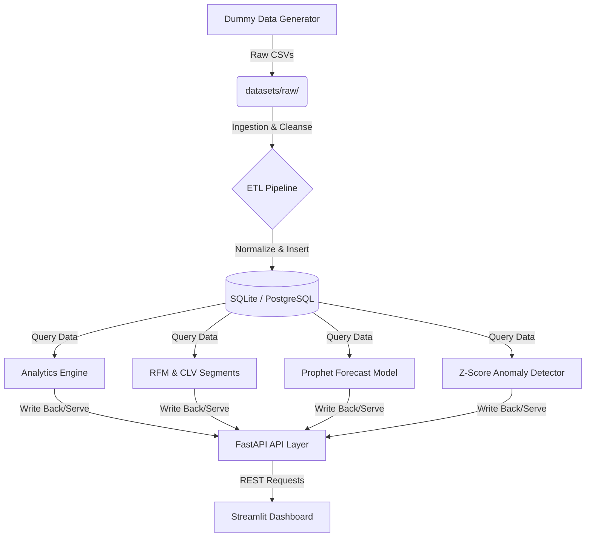
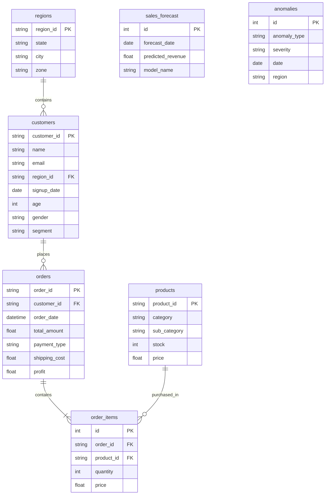

# 📊 SalesPulse – Real-Time Sales Analytics, Forecasting & Customer Intelligence

[](https://www.python.org/)
[](https://fastapi.tiangolo.com/)
[](https://streamlit.io/)
[](https://facebook.github.io/prophet/)
[](https://www.docker.com/)

**SalesPulse** is a production-grade, end-to-end data analytics and predictive modeling pipeline. It cleanses dirty transactional data, aggregates business KPIs, runs machine learning models for customer behavior (RFM & churn), forecasts future daily revenue, detects financial anomalies, and visualizes everything inside an executive dashboard.

---

## 🏗️ System Architecture

The workflow follows a classic modern data stack architecture, from raw data generation down to RESTful API serving and visualization:



---

## 🗄️ Database Schema & ER Diagram

SalesPulse comes pre-configured with a clean relational model. It defaults to an SQLite file database (`salespulse.db`), but can easily be configured to target PostgreSQL using standard environment variables.



---

## 🚀 Key Features & Modules

### 1. Ingestion & ETL Pipeline (`app/ingestion/`)
- Extracts messy datasets, drops duplicate transactional logs, and standardizes names/addresses.
- Handles missing data (e.g. median ages, default email flags).
- Loads cleaned relationships atomically into the database via SQLAlchemy.

### 2. KPI Analytics Engine (`app/analytics/`)
- Computes vital operational performance indicators: **Total Revenue**, **Profit Margins**, **Average Order Values (AOV)**, and monthly performance trends.

### 3. Customer Intelligence Engine (`app/customer_intelligence/`)
- **RFM Analysis**: Automatically buckets users based on Recency, Frequency, and Monetary scores (Premium, Loyal, At Risk, Churn Risk, New, Low Value).
- **Churn Classifier**: Builds and fits a `RandomForestClassifier` on RFM traits to flag customers with high churn risk.
- **CLV Estimator**: Computes predicted Customer Lifetime Value based on historical orders and loyalty lifespans.

### 4. Forecasting Engine (`app/forecasting/`)
- Integrates Facebook **Prophet** to train on historical aggregated daily orders, learning weekly/monthly seasonality to project next 30 days of sales.

### 5. Anomaly Detection (`app/anomaly/`)
- Analyzes daily sales volatility using statistical Z-Score tests.
- Flags and logs unexpected spikes or sudden revenue drops (outliers exceeding `abs(Z) > 2.0`).

---

## ⚡ REST API Reference

The backend operates as a decoupled REST service powered by FastAPI.

| Endpoint | Method | Tag | Description |
| :--- | :--- | :--- | :--- |
| `/` | `GET` | System | API Root & Health Check |
| `/analytics/revenue` | `GET` | Analytics | Total Revenue aggregated across all orders |
| `/analytics/profit-margin` | `GET` | Analytics | Overall profit margin ratio (%) |
| `/analytics/top-products` | `GET` | Analytics | Top products by revenue (supports optional `limit` query parameter) |
| `/analytics/monthly-revenue` | `GET` | Analytics | Aggregated monthly revenue trends |
| `/customers/calculate-rfm` | `POST` | Customers | Computes and updates RFM scores and customer segments in DB |
| `/customers/segments` | `GET` | Customers | Retrieves customer distribution counts by segment |
| `/customers/churn-risk` | `GET` | Customers | Predicts churn risk probability using Random Forest |
| `/customers/clv` | `GET` | Customers | Retrieves top 10 customers based on Lifetime Value (CLV) |
| `/forecast/generate` | `POST` | Forecast | Fits Prophet model and precomputes 30-day forecast to DB |
| `/forecast/` | `GET` | Forecast | Retrieves precomputed daily revenue forecast |
| `/anomalies/detect` | `POST` | Anomalies | Runs Z-score anomaly detection and records outliers |
| `/anomalies/` | `GET` | Anomalies | Retrieves detected revenue anomalies (spikes/drops) |

> [!NOTE]
> FastAPI automatically serves interactive Swagger docs at: `http://localhost:8000/docs`.

---

## ⚙️ Local Setup Guide

Follow these simple steps to spin up the application in a virtual environment.

### 1. Configure the Environment
```bash
# Clone the repository and navigate inside
cd Sales-ETL-Forecasting-Pipeline

# Create and activate virtual environment
python3 -m venv venv
source venv/bin/activate

# Install all system requirements
pip install -r requirements.txt

# Export local pythonpath
export PYTHONPATH=.
```

### 2. Generate Data & Precompute Models
```bash
# Step A: Synthesize raw dirty datasets
python scripts/generate_dummy_data.py

# Step B: Run the ETL pipeline to clean and load SQL tables
python app/ingestion/etl.py

# Step C: Precompute RFM segments, forecasting models, and statistical anomalies
python scripts/precompute.py
```

### 3. Spin Up Services
In terminal 1, launch the FastAPI server:
```bash
uvicorn app.main:app --reload
```

In terminal 2, run the Streamlit Executive Dashboard:
```bash
export PYTHONPATH=.
streamlit run dashboard/app.py
```

- **API Documentation**: [http://localhost:8000/docs](http://localhost:8000/docs)
- **Interactive Dashboard**: [http://localhost:8501](http://localhost:8501)

---

## 🐳 Running with Docker

You can run the entire decoupled backend and frontend using Docker and Docker Compose.

```bash
# Start all containers in the background
docker-compose up --build -d

# Verify service logs
docker-compose logs -f
```

---

## 📁 File Structure

```bash
Sales-ETL-Forecasting-Pipeline/
├── app/
│   ├── analytics/               # Aggregation & KPI logic
│   ├── anomaly/                 # Z-Score outlier detection
│   ├── api/                     # FastAPI route handlers
│   ├── customer_intelligence/   # RFM clustering, CLV & RandomForest Churn
│   ├── forecasting/             # Prophet forecasting models
│   ├── ingestion/               # ETL pipelines (clean/transform/load)
│   ├── models/                  # SQLAlchemy model declarations
│   ├── database.py              # DB engines and session managers
│   └── main.py                  # API entrypoint
├── dashboard/
│   └── app.py                   # Streamlit layout & Plotly charts
├── datasets/
│   └── raw/                     # Raw synthetic CSV inputs
├── scripts/
│   ├── generate_dummy_data.py   # Synthesizer script for mock raw data
│   └── precompute.py            # CLI script to invoke precomputes
├── docker-compose.yml           # Compose spec
├── Dockerfile                   # Docker instruction recipe
└── requirements.txt             # Python packages manifest
```
